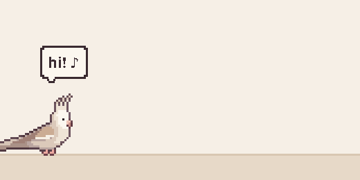

# Zengo

A desktop pet of Zengo, a cinnamon white-face cockatiel. Pixel art, Windows and Linux.



## Install

From the [latest release](../../releases/latest):

- **Windows**: `zengo-<version>-setup.exe` installs him for you alone (no admin
  rights needed), with a Start-menu entry, start at login if you like, and an
  uninstaller in *Settings > Apps*. Or just run `zengo-windows-x86_64.exe`.
- **Debian, Ubuntu, Mint**: `sudo apt install ./zengo_<version>_amd64.deb`, then
  find *Zengo* in your applications menu.
- **Any Linux**: `Zengo-<version>-x86_64.AppImage`: `chmod +x` it and run it.
  The first time, it adds itself to your applications menu.
- Or the plain Linux binary, `zengo-linux-x86_64` (`chmod +x` it first).

On Linux he needs X11, or XWayland under Wayland (see below), and Qt's
`libxcb-cursor0` (the .deb installs it).

Zengo perches on the bottom edge of the screen (above the taskbar), idles and
blinks, waddles about, preens, takes flights around the screen, watches and
follows the cursor, and falls asleep when you're away or late at night. Rest the
mouse still above the ground near him and he may fly up and perch on the pointer;
move it and he flutters off.

Every 10 to 20 minutes a leafy branch grows out from the side of the screen. He
flies over and sits on it facing you: looking about, preening, fluffing up,
napping if it's late, until he flies off and it withdraws. Drop him just above
it and he grabs it. He also flies up onto the tops of your windows (ones that
aren't maximized) and sits there; move the window and he rides along, close,
minimize, maximize or cover it and he flutters down. Now and then he sits facing you on the ground too.

With more than one screen he flies across to the one beside his now and then
(and, devoted, follows your pointer there); unplug the screen he's on and he
comes over to another, cage, seeds and all.

He has a fullness meter. It drains with time, faster when he's busy (flying
burns three times what sitting does, sleeping very little), and every seed fills
it up a bit. Every 30 s he may get hungry: never when he's well fed, likelier the
emptier he is. Hungry, he eats a stack of seeds if you've put some out; if not,
he flies over to your pointer and asks for some (from a cage, he just asks).
Caged, after 5 minutes he tries the latch once a minute: 15% the first time, 1%
more each try, 3% less for every time you've fed him in there, all times
(1 − his bond): the closer he feels to you, the less he wants out, and devoted
through and through he never tries.

His escape progress is his own, not the cage's: time caged adds up across
cagings, so letting him out and catching him again later carries on where he
left off. Only escaping starts it over.

He also grows fond of you, or not. Petting (up to a point each hour), feeding
him (more so when he's hungry), letting him out of the cage and simply having your
pointer near him bring him closer; catching him, every minute caged, making him ask
twice for food and dropping him from high up push him away. Left alone he drifts
back to the middle. Devoted, he follows your pointer, potters over to sit near
where you work, chirps more, sometimes whistles a heart, and when you come back
after ten minutes away he flies over to greet you. Grumpy, he walks off when your
pointer comes near, ignores your first poke, and sulks with his back to you,
peeking round now and then to see if you've noticed.

### Helping you work

- **Focus timer** (*Focus…* in the tray menu, or the *Focus* tab of his
  settings): 25 minutes' focus and a 5-minute break to begin with, a long break
  after every few sessions, all adjustable. While you focus he settles by the
  side of the screen, dozes and preens, and doesn't make a sound: no chirps, no
  asking for food. At the break he stretches, comes to your pointer and calls
  you ("break! ♪"); now and then he suggests a bath or a game. When it's over
  he asks "back to it?", with a Start button by his head (or carries on by
  himself, if you chose). The time left shows in his needs strip and as a ring
  round his tray icon. Pause and Stop are in the tray menu. A session in
  progress carries on across a restart.
- **Break reminders**: not using the timer, after a long stretch at the
  computer (50 minutes to begin with, or off) he comes over to suggest a
  break: "stretch?" Once more ten minutes later, then he lets it go.
- **The chasing game**: wiggle the pointer quickly near him. He crouches, then
  chases it in hops and short flights, pouncing when it stops and trilling
  when he catches it. Rest the pointer and he gives up; after about a minute
  he's tired and pants.

### Life round him

- **His bath**: every half hour to an hour and a half (sooner in summer) a
  shallow dish of water appears on the ground near him for a few minutes. He
  hops in, dips his head, splashes with flicking wings (droplets flying), hops
  out and shakes himself dry in a spray. Then he's damp for a minute, darker
  and with his crest slicked down, and won't fly till he's dry.
- **Toys**: put a bell or a mirror out from the *Life* tab of his settings. The
  bell hangs under the branch's tip, or from his cage roof; he pecks it and it
  swings and rings. The mirror stands on the ground near him, or hangs on his
  cage bars; he goes and chats to his reflection. Playing makes him hungrier,
  and brings him a little closer to you (up to a point each hour).
- **Moulting**: now and then a feather drifts down from him and lies where it
  lands until you click it away (at most three at a time). Some days are
  moulting days: more feathers, more preening.
- **Seasons**, from your computer's date (and your hemisphere, worked out from
  your time zone): a scarf and puffing up in winter, with snow drifting past
  the branch; more song in spring; panting on hot summer afternoons, and more
  baths; leaves falling from the branch in autumn. Late in the evening he's
  drawn a little dimmer. All of it can be turned off in the *Life* tab, and
  nothing is looked up online.

His right-click menu opens with a slim live strip of all this, one coloured
number each: ♥ his bond, ◐ his fullness, ∴ the seeds out, and ⇥ his escape
(the time to his first try, then his odds at the next). Hover one for the rest:
his mood, his odds of getting hungry at the next check, when he next tries. Where he was
and which way he faced, whether he was caged (and where the cage hung or stood,
with its dish), his bond, fullness, hunger, seeds and escape progress are all
remembered between runs, in `~/.local/share/Zengo/state.json` (`%APPDATA%\Zengo` on Windows).

### Making him yours

- **Settings** (*Settings…* in his menu or the tray): his size (2× to 5×, changed
  on the spot), sound and volume, how often a branch grows, how fast he gets
  hungry, starting at login, and *Reset Zengo* to start over (your settings and
  voice files stay). The *Life* tab puts his toys out, sets how often his bath
  comes, and turns the seasons on or off (or sets your hemisphere). Kept in `settings.json` beside the state file; command-line
  flags win over it.
- **Teach him words** (*Teach Zengo…* in the *Words* tab of his settings): type a word or short phrase and choose
  when he'll say it: any time, or at a moment (greeting you, asking for food,
  after a meal, being petted, in the cage, getting free). He cocks his head,
  listens and tries it back. It takes about five lessons at least an hour apart
  (fewer the closer he feels to you); until then his tries come out garbled.
  He keeps up to ten words, forgetting the least used for an eleventh.
- **His words and sounds are files you can edit**: `phrases.toml` (a list per
  moment) and `sounds.toml` (each sound built-in or a WAV file), in the same
  folder. The *Words* and *Sounds* tabs of his settings edit them too. A broken
  file is reported once and his built-in voice used.
- **Make him sound like your bird**: *Record…* in the *Sounds* tab records up to
  three seconds from your microphone (your cockatiel, or you whistling), trims
  the silence, plays it back, and keeps it as the sound you chose. The
  microphone is open only while you hold the Record button, and never otherwise.
- **Tray icon**: his head in the system tray. Click it and he flies to the middle
  of the screen ("here I am!"); its menu hides him (he flies off the side and
  waits out of sight) or shows him, feeds him, opens his settings or quits. A
  dot on it means he needs you: hungry, or caged.
- **Start at login**: in his settings. On Linux it's
  `~/.config/autostart/zengo.desktop`; on Windows, the current user's *Run* key.

| Input | Reaction |
|---|---|
| Left click | Crest up, startled |
| Double-click | Bobs his head and whistles: you hear the tune and see it in a cloud |
| Type (anywhere) | Sitting about, he bobs his head along. Only the timing of your input is noticed, never the keys |
| Stroke the mouse gently back and forth over him | Fluffs up, shuts his eyes and leans into it, with hearts; a happy shake when you stop |
| Left drag | Picked up: hangs from the cursor, swings, flaps if moved fast. Let go and he keeps his momentum, glides in and shakes it off |
| Click a feather he's dropped | It's cleared away |
| Wiggle the pointer quickly near him | A game of chase |
| Right click | Menu: a live strip of his needs, then *Feed Zengo*, *Catch Zengo* (or *Let Zengo out*), *Settings…* and *Quit Zengo*. Sound, starting at login and teaching him words are all in *Settings…* |
| Click his tray icon | He flies to the middle of your screen: "here I am!" |
| *Feed Zengo (n/3)* | Pours out a stack of sunflower seeds, his favourite: up to three stacks, the pile filling as you add. He eats one stack whenever he gets hungry; caged, they go in his dish |
| *Catch Zengo*, then drag a box around him | Caged where he is, and furious about it. Drag the cage: let go near the top and it hangs from a chain, near a side and it sits on a shelf (unless that's too near the floor for one), anywhere else it falls to the ground. Petting him through the bars calms him; *Let Zengo out* opens the door |

## Run from source

```sh
python -m venv .venv
.venv/bin/pip install -e '.[dev]'      # Windows: .venv\Scripts\pip
.venv/bin/zengo                         # or: python -m zengo
.venv/bin/zengo --scale 3               # bigger bird (overrides the size in his settings)
.venv/bin/zengo --sprites art.json      # use hand-drawn frames (see below)
.venv/bin/zengo --branch-now            # grow a branch straight away
.venv/bin/zengo --bath-now              # put his bath out straight away
.venv/bin/zengo --season winter         # show a season whatever the date
.venv/bin/zengo --quick                 # short timers: cage escapes in seconds (odds times 1 − bond), hunger every 20 s, a bath a minute, feathers twice a minute
```

Requires Python 3.11+. On Linux, Qt's X11 plugin needs `libxcb-cursor0`
(`sudo apt install libxcb-cursor0` on Debian/Ubuntu/Mint), including for the
built binary. X11 is fully supported. Under Wayland, Qt
cannot place windows at absolute positions, so force XWayland:
`QT_QPA_PLATFORM=xcb zengo`. (Native Wayland, through the layer-shell protocol,
is planned for 1.1.)

## Build a standalone executable

```sh
python scripts/build.py           # -> dist/zengo (Linux) or dist/zengo.exe (Windows)
python scripts/package_linux.py   # -> a .deb (and an AppImage, given --appimagetool)
iscc packaging/windows/zengo.iss  # -> the Windows installer (Inno Setup 6)
```

PyInstaller does not cross-compile; build on each target OS.

### Releasing

CI runs the tests on every push. To publish a release, bump `version` in
`pyproject.toml`, then tag and push:

```sh
git tag v0.1.0 && git push origin v0.1.0
```

GitHub Actions builds both executables and attaches them to a release for the tag.

## Develop

```sh
pytest
ruff check . && ruff format --check .
python scripts/preview_sprites.py sprites.png   # contact sheet of every frame
```

### Layout

```
src/zengo/
  app.py            composition root and frame loop
  config.py         tunables (speeds, timings, scale)
  animation.py      Clip and Animator: frame timing, no rendering
  world.py          World protocol: what the pet can observe
  behavior/
    body.py         position and facing
    context.py      what states may read and mutate
    states.py       one class per behaviour
    flight.py       smooth flight paths through waypoints
    scenery.py      the branch: when it grows, stays and withdraws
    bath.py         his bath dish: when it comes and goes
    toys.py         his bell and mirror: where they are, the bell's swing
    focus.py        the focus timer: sessions, breaks, pausing
    reminders.py    break reminders, when you're not using the timer
    chase.py        noticing a wiggle of the pointer: a game of chase
    moult.py        feathers he drops, and moulting days
    seasons.py      the season, from the date and your hemisphere
    weather.py      snow and falling leaves round the branch
    effects.py      droplets, snowflakes and leaves in the air
    petting.py      tells gentle strokes of the pointer from passing by
    typing.py       notices you're typing (input with the pointer still)
    cage.py         the cage: carried, hung on a chain, shelved or dropped
    food.py         seeds put out for him, and his fullness and hunger
    bond.py         how close he feels to you, and noticing you come back
    status.py       a read-out of his needs, for the menu
    voice.py        his phrases and sounds, from phrases.toml and sounds.toml
    vocabulary.py   words you teach him: lessons, garbled tries, forgetting
    memory.py       what he remembers between runs
    machine.py      Brain: runs states, routes mouse input
  settings.py       your settings, laid over config.py, under the command-line flags
  sounds.py         his chirps, whistles and trills, synthesized
  sprites/
    palette.py      Zengo's colours
    art.py          ASCII pixel-art layers
    compose.py      layers -> RGBA frames, generated outline
    frames.py       named frames and canvas geometry
    clips.py        animation catalogue
    branch.py       the branch's art and where he can sit on it
    cage.py         the cage, chain and shelf art
    food.py         the seed pile
    looks.py        damp, a scarf, dimmed: on top of any pose
    bath.py         his bath dish
    toys.py         the bell and the mirror
    feather.py      a dropped feather
    effects.py      droplets, snowflakes, leaves
  ui/
    qt_world.py     World backed by Qt screens and cursor
    sprites.py      frames -> scaled, mirrored pixmaps and click masks
    window.py       translucent always-on-top window, gestures
    sheet_loader.py Aseprite JSON + PNG -> frames
    branch_window.py click-through window the branch is drawn in
    bubble_window.py the speech cloud above his head
    cage_window.py  the draggable cage, and the chain or shelf under it
    catch_overlay.py the dimmed screen you drag a box on to catch him
    food_window.py  the seed pile's window
    bath_window.py  his bath dish's window
    toy_window.py   the bell's and the mirror's windows
    focus_tab.py    the Focus tab: the timer's lengths, Start, Pause and Stop
    start_button.py "▶ Start" by his head when the break's over
    feather_window.py a dropped feather, clickable
    effects_window.py one click-through window for every droplet and snowflake
    status_panel.py the live needs strip in his menu
    state_file.py   the file what he remembers is kept in
    input_idle.py   time since any input, from the system (never the keys)
    desktop_windows.py other apps' windows, for perching on their tops
    sound.py        plays his sounds (or your WAV files in their place)
    settings_window.py the settings window and its General, Life and Focus tabs
    voice_tabs.py   the Words and Sounds tabs
    teach_box.py    the "Teach Zengo…" box
    recorder.py     recording a sound from the microphone, only while held
    tray.py         his head in the system tray, and its menu
    autostart.py    starting at login (freedesktop autostart, Windows Run key)
    menu_entry.py   run as an AppImage, putting himself in the applications menu
```

Only `ui/` and `app.py` import Qt. Everything else is plain Python and is
tested headless against a fake `World`.

### Editing the art

Frames are text in `sprites/art.py`, drawn facing right on a 52x34 grid. Each
character is a palette key from `sprites/palette.py`; `.` leaves the pixel
below untouched and `_` erases it. Don't draw outlines: they are generated,
each edge taking a dark shade of the colour it borders.

Zengo is drawn to a real cockatiel's proportions: a small white-faced head with
a tall crest, a slim body sloping back and a tail as long as the rest of him.
Perched poses are the base drawing (`TAIL`, `BODY`, `WING_FOLDED`, `HEAD`, `CREST`,
`LEGS`) plus small overlays: a shifted head, another crest, closed eyes. Flight
has its own level body with the head moved forward and a long pointed wing in
one of four beat positions (up, level, down, recover); the glide holds the wing
level and the landing flares it up. Turning round in the air, he banks through a
front view with both wings spread (`turn_up`, `turn_down`). Sitting facing you
(`FRONT_*` layers) is drawn symmetric about the anchor column; on the branch the
same poses add the tail hanging down behind it. The rows below the ground row are only used
by the downstroke. `frames.py` stacks layers into named frames and `clips.py`
sequences them. `tests/test_sprites.py` checks that frames line up with the
ground row and that every clip refers to a real frame.

### Hand-drawn frames

Any frame can be replaced by art from a pixel editor. In Aseprite (or
LibreSprite), draw on a 54x36 canvas facing right, with the feet's lowest
pixel on row 29 and the gap between the feet on column 31 (zero-based). Name
each frame after the one it replaces (`perch`, `blink`, `alert`, `step_back`,
`step_front`, `preen_a`, `preen_b`, `sleep`, `wings_up`, `wings_level`,
`wings_down`, `wings_recover`, `held`, `held_blink`, `held_kick_a`, `held_kick_b`,
`held_look`, `held_flick`, `shake_a`, `shake_b`, `turn_up`, `turn_down`, the
front views `front_perch`, `front_blink`, `front_look_l`, `front_look_r`,
`front_alert`, `front_preen_a`, `front_preen_b`, `front_fluff_a`, `front_fluff_b`,
`front_sleep`, `front_petted_a`, `front_petted_b`, `front_whistle_a`, `petted_a`,
`petted_b`, `whistle_a`, and the same front views on the branch as `branch_...`) and export a sprite sheet with JSON data, hash or array layout.
Frames not in the sheet keep the built-in art. Run with
`zengo --sprites sheet.json`. Draw your own outline here; generated outlines
only apply to the built-in art.

### Adding a behaviour

Subclass `State` in `behavior/states.py`: set `clip`, override `enter` and/or
`step`, and return the next state from `step` when done. Add it to the weights
in `choose_activity`.

## License

MIT. See [LICENSE](LICENSE).
